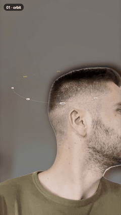
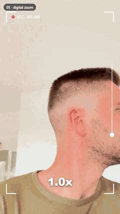
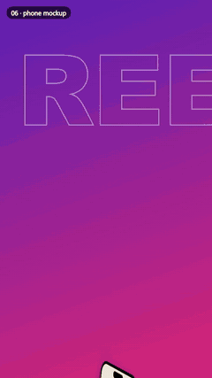
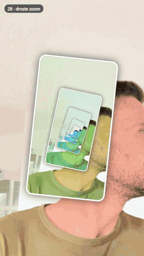
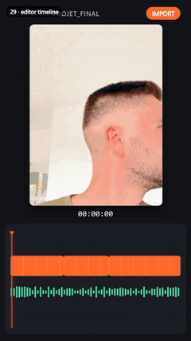

# Les effets vidéo de mon Reel, faits avec Claude Code

Aucun logiciel de montage. Tu décris l'effet, Claude Code l'écrit en HTML et le rend en vidéo avec **HyperFrames** (open source, gratuit).

Ici tu as :
- **les 18 effets de la vidéo**, avec le code complet de chacun (dossier `effets-du-reel/`) ;
- **20 effets prêts à l'emploi** en plus, tirés du catalogue HyperFrames.

## 1. Installer (une seule fois)

Il te faut [Claude Code](https://claude.com/claude-code) et [Node.js](https://nodejs.org). Puis, dans un terminal :

```bash
claude plugin marketplace add heygen-com/hyperframes
claude plugin install hyperframes@hyperframes
```

## 2. Les 18 effets de la vidéo

Clique sur un effet pour avoir son code et la marche à suivre.

| <a href="effets-du-reel/01-texte-derriere-toi"></a> | <a href="effets-du-reel/02-mots-autour-de-la-tete"></a> | <a href="effets-du-reel/03-mur-d-ecrans"></a> |
|:-:|:-:|:-:|
| **1. Texte derrière toi** | **2. Mots qui tournent autour de ta tête** | **3. Mur d'écrans** |
| <a href="effets-du-reel/04-interface-autour-de-toi"></a> | <a href="effets-du-reel/05-zoom-numerique"></a> | <a href="effets-du-reel/06-telephone"></a> |
| **4. Interface qui apparaît autour de toi** | **5. Zoom numérique façon caméra** | **6. Toi dans un téléphone** |
| <a href="effets-du-reel/07-mur-de-titres"></a> | <a href="effets-du-reel/08-graphique-qui-grimpe"></a> | <a href="effets-du-reel/09-recul-dans-un-ecran"></a> |
| **7. Mur de gros titres** | **8. Graphique qui grimpe** | **9. Recul : tu es dans un écran** |
| <a href="effets-du-reel/10-fond-vert-sans-fond-vert"></a> | <a href="effets-du-reel/11-decoupe-papier"></a> | <a href="effets-du-reel/12-doodle"></a> |
| **10. Fond vert, sans fond vert** | **11. Découpe papier** | **12. Doodle dessiné à la main** |
| <a href="effets-du-reel/13-couverture-de-magazine"></a> | <a href="effets-du-reel/14-portail"></a> | <a href="effets-du-reel/15-confettis"></a> |
| **13. Couverture de magazine** | **14. Portail vers une autre scène** | **15. Explosion de confettis** |
| <a href="effets-du-reel/16-manga"></a> | <a href="effets-du-reel/17-zoom-infini"></a> | <a href="effets-du-reel/18-timeline-de-montage"></a> |
| **16. Impact manga** | **17. Zoom infini** | **18. Timeline de montage** |

| # | Effet | À dire à Claude |
|---|---|---|
| 1 | [Texte derrière toi](effets-du-reel/01-texte-derriere-toi) | « Mets un titre géant derrière moi : devant le fond, mais derrière ma tête. » |
| 2 | [Mots qui tournent autour de ta tête](effets-du-reel/02-mots-autour-de-la-tete) | « Fais tourner ces mots en anneau autour de ma tête, ils passent devant puis derrière moi. » |
| 3 | [Mur d'écrans](effets-du-reel/03-mur-d-ecrans) | « Mets derrière moi un mur de tuiles colorées numérotées qui s'allument une à une. » |
| 4 | [Interface qui apparaît autour de toi](effets-du-reel/04-interface-autour-de-toi) | « Fais apparaître des cartes d'appli autour de moi : notification « Nouveau lead », bouton Envoyer cliqué, petit graphique. » |
| 5 | [Zoom numérique façon caméra](effets-du-reel/05-zoom-numerique) | « Zoom numérique sur mon visage avec le cadre de mise au point, l'indicateur REC et « 2.5x ». » |
| 6 | [Toi dans un téléphone](effets-du-reel/06-telephone) | « Mets ma vidéo dans un iPhone sur fond dégradé, avec des bulles « +1 abonné » qui sortent. » |
| 7 | [Mur de gros titres](effets-du-reel/07-mur-de-titres) | « Derrière moi, un mur de titres de presse qui défilent en biais. » |
| 8 | [Graphique qui grimpe](effets-du-reel/08-graphique-qui-grimpe) | « Des barres et une courbe qui montent derrière moi jusqu'à « +307 % ». » |
| 9 | [Recul : tu es dans un écran](effets-du-reel/09-recul-dans-un-ecran) | « La caméra recule et on découvre que je suis dans un écran posé sur un bureau. » |
| 10 | [Fond vert, sans fond vert](effets-du-reel/10-fond-vert-sans-fond-vert) | « Remplace mon fond par une ville au coucher de soleil, sans fond vert. » |
| 11 | [Découpe papier](effets-du-reel/11-decoupe-papier) | « Style collage : moi découpé avec un contour papier blanc, fond de papiers déchirés, titre « PAPER CUT ». » |
| 12 | [Doodle dessiné à la main](effets-du-reel/12-doodle) | « Des gribouillis dessinés à la main qui tremblent autour de moi : cercle, flèche, « WOW! ». » |
| 13 | [Couverture de magazine](effets-du-reel/13-couverture-de-magazine) | « Mets-moi en couverture de magazine avec ce titre, le nom du magazine passe derrière ma tête. » |
| 14 | [Portail vers une autre scène](effets-du-reel/14-portail) | « Un cercle s'ouvre sur moi et m'emmène dans un autre décor avec « NOUVEAU MONDE ». » |
| 15 | [Explosion de confettis](effets-du-reel/15-confettis) | « Explosion de confettis derrière moi avec « BRAVO » doré. » |
| 16 | [Impact manga](effets-du-reel/16-manga) | « Effet manga : lignes de vitesse, trame de points et bulle « BOOM! ». » |
| 17 | [Zoom infini](effets-du-reel/17-zoom-infini) | « Zoom infini : je suis dans un écran, qui est dans un écran, qui est dans un écran… » |
| 18 | [Timeline de montage](effets-du-reel/18-timeline-de-montage) | « Montre ma vidéo dans un logiciel de montage : forme d'onde, tête de lecture, les silences coupés en rouge. » |

**Le plus simple :** télécharge le repo (bouton vert *Code* → *Download ZIP*), ouvre Claude Code dans le dossier d'un effet, glisse ta vidéo dedans et dis : « Refais cet effet avec ma vidéo ».

## 3. 20 effets prêts à l'emploi en plus


| # | Animation | À dire à Claude | Bloc prêt à l'emploi |
|---|---|---|---|
| 1 | **Texte derrière toi** | « Détoure-moi et mets le titre XXL derrière moi, devant le fond » | détourage via `/media-use` |
| 2 | **Mots qui tournent autour de ta tête** | « Fais tourner ces mots en cercle autour de ma tête » | [carousel-text-circle](https://github.com/heygen-com/hyperframes/tree/main/registry/blocks/carousel-text-circle-1) |
| 3 | **Mur d'écrans** | « Transition en mur d'écrans qui se multiplient » | [mk-clone-wall-transition](https://github.com/heygen-com/hyperframes/tree/main/registry/blocks/mk-clone-wall-transition) |
| 4 | **Interface qui apparaît** | « Fais apparaître cette capture d'appli en 3D à côté de moi » | [ui-3d-reveal](https://github.com/heygen-com/hyperframes/tree/main/registry/blocks/ui-3d-reveal) |
| 5 | **Zoom numérique** | « Zoom cinématique sur mon visage à cette phrase » | [cinematic-zoom](https://github.com/heygen-com/hyperframes/tree/main/registry/blocks/cinematic-zoom) |
| 6 | **Mur de titres** | « Un nuage de titres de presse qui envahit l'écran » | [hw-text-cloud](https://github.com/heygen-com/hyperframes/tree/main/registry/blocks/hw-text-cloud) |
| 7 | **Graphique qui grimpe** | « Une courbe qui monte avec le chiffre au bout » | [mk-line-graph](https://github.com/heygen-com/hyperframes/tree/main/registry/blocks/mk-line-graph) |
| 8 | **Couverture de magazine** | « Mets-moi en couverture de magazine avec ce titre » | sur mesure |
| 9 | **Portail** | « Un portail qui s'ouvre et me fait passer à la scène suivante » | [vfx-portal](https://github.com/heygen-com/hyperframes/tree/main/registry/blocks/vfx-portal) |
| 10 | **Confettis** | « Explosion de confettis quand je dis le chiffre » | [confetti](https://github.com/heygen-com/hyperframes/tree/main/registry/components/confetti) |
| 11 | **Zoom infini** | « Zoom infini à travers une galerie d'images » | [gallery-tunnel](https://github.com/heygen-com/hyperframes/tree/main/registry/blocks/gallery-tunnel) |
| 12 | **Sous-titres karaoké** | « Sous-titres mot par mot, le mot dit est surligné » | [caption-pill-karaoke](https://github.com/heygen-com/hyperframes/tree/main/registry/components/caption-pill-karaoke) |
| 13 | **Verre liquide iOS 26** | « Une carte en verre liquide façon iPhone avec ce texte » | [ios26-liquid-glass](https://github.com/heygen-com/hyperframes/tree/main/registry/blocks/ios26-liquid-glass) |
| 14 | **Glitch** | « Un effet glitch sur la coupe » | [glitch](https://github.com/heygen-com/hyperframes/tree/main/registry/blocks/glitch) |
| 15 | **Pluie de notifications** | « Des notifications qui tombent en cascade » | [notification-cascade](https://github.com/heygen-com/hyperframes/tree/main/registry/blocks/notification-cascade) |
| 16 | **Post X à l'écran** | « Affiche ce tweet en gros, animé » | [x-post](https://github.com/heygen-com/hyperframes/tree/main/registry/blocks/x-post) |
| 17 | **Compteur qui défile** | « Le chiffre qui compte de 0 à 10 000 » | [count-up](https://github.com/heygen-com/hyperframes/tree/main/registry/components/count-up) |
| 18 | **Code qui se tape** | « Une fenêtre de code qui s'écrit toute seule » | [code-typing](https://github.com/heygen-com/hyperframes/tree/main/registry/blocks/code-typing) |
| 19 | **Bouton s'abonner** | « Le bouton s'abonner Instagram qui se clique à la fin » | [instagram-follow](https://github.com/heygen-com/hyperframes/tree/main/registry/blocks/instagram-follow) |
| 20 | **Écran qui explose** | « L'image éclate en morceaux de verre » | [vfx-shatter](https://github.com/heygen-com/hyperframes/tree/main/registry/blocks/vfx-shatter) |

**Bonus** : tableau d'aéroport qui défile ([split-flap-board](https://github.com/heygen-com/hyperframes/tree/main/registry/blocks/split-flap-board)), bandeau info façon JT ([news-ticker](https://github.com/heygen-com/hyperframes/tree/main/registry/blocks/news-ticker)).

Il y en a plus de 400 autres : demande à Claude « montre-moi le catalogue HyperFrames » ou va voir [le registre complet](https://github.com/heygen-com/hyperframes/tree/main/registry).

---

Tu veux des outils IA sur mesure pour ta boîte ? **Aptibots** : [aptibots.com](https://aptibots.com) · Instagram [@hespel_armand](https://www.instagram.com/hespel_armand/)
