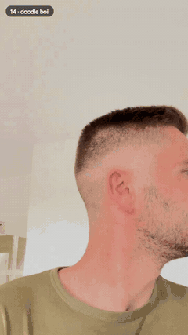

# Doodle dessiné à la main

**À dire à Claude :** « Des gribouillis dessinés à la main qui tremblent autour de moi : cercle, flèche, « WOW! ». »

## Le refaire avec ta vidéo

1. Copie ce dossier.
2. Ajoute dedans :
- `clip.mp4` = ta vidéo.
3. Dans le dossier : `npx hyperframes render --output effet.mp4`

Tu peux aussi juste ouvrir Claude Code dans ce dossier et lui dire : « Adapte cet effet à ma vidéo et change le texte en … ».
Format : vertical 720×1280, 5 secondes.
