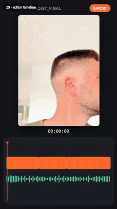

# Timeline de montage

**À dire à Claude :** « Montre ma vidéo dans un logiciel de montage : forme d'onde, tête de lecture, les silences coupés en rouge. »

## Le refaire avec ta vidéo

1. Copie ce dossier.
2. Ajoute dedans :
- `clip.mp4` = ta vidéo.
3. Dans le dossier : `npx hyperframes render --output effet.mp4`

Tu peux aussi juste ouvrir Claude Code dans ce dossier et lui dire : « Adapte cet effet à ma vidéo et change le texte en … ».
Format : vertical 720×1280, 5 secondes.
